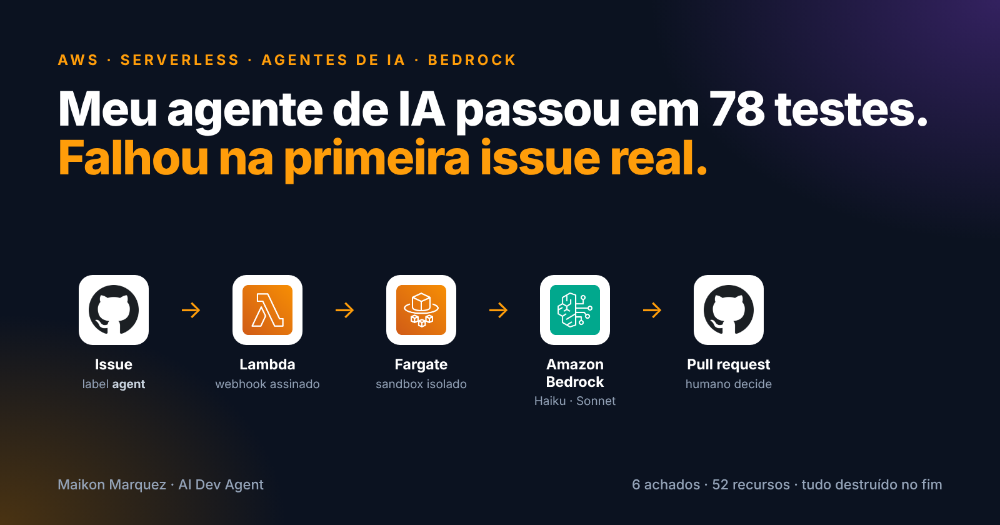
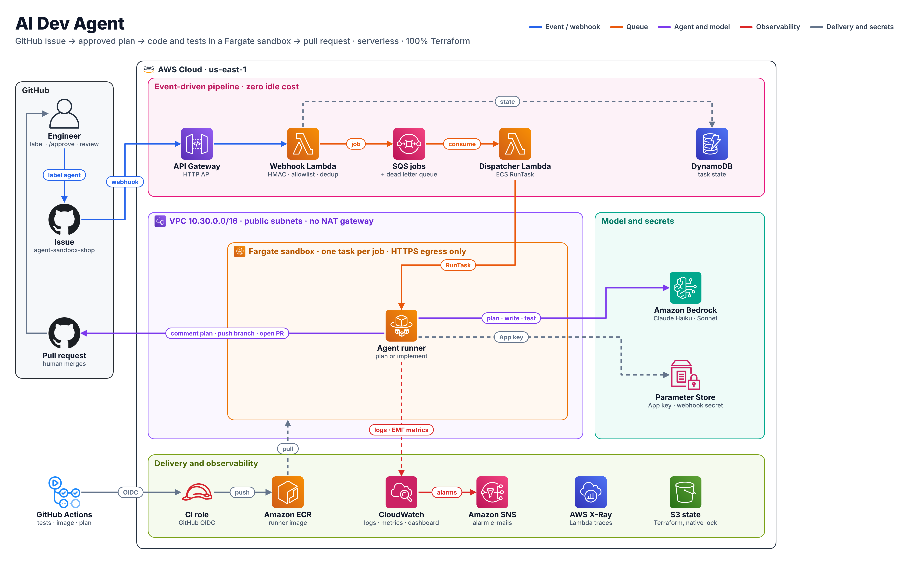

# AI Dev Agent



> An autonomous development agent on AWS. Label a GitHub issue, approve the plan it proposes, and it writes the code and the tests in an isolated Fargate sandbox and opens a pull request with a report. It never merges: a human always decides.


## Architecture



<sub>Generated from code with the official AWS icons: [docs/diagrams/architecture.py](docs/diagrams/architecture.py).</sub>

## How it works

1. You add the label `agent` to an issue in [agent-sandbox-shop](https://github.com/MaikonJm/agent-sandbox-shop).
2. GitHub calls the webhook. The **webhook Lambda** checks the signature, the sender and duplicates, records the task in DynamoDB and queues a job.
3. The **dispatcher Lambda** starts one **Fargate task**. The agent clones the repository, explores it with read-only tools and **comments a plan** on the issue.
4. You reply `/approve` (or `/revise <feedback>`).
5. A new task implements the plan, runs the tests and, only if they pass, **pushes `agent/issue-N` and opens a PR** with what changed, how it was tested, open questions, tokens and cost.
6. You review and merge.

## First run on AWS

The whole project ran end to end on AWS on 13 Nov 2026: both stacks applied, one issue solved, everything destroyed, in about 1 h 40 min.

| | |
| --- | --- |
| Task | [Issue #1](https://github.com/MaikonJm/agent-sandbox-shop/issues/1) of the sandbox: the cart total ignored the quantity of the last item |
| Plan | Commented in 9 s and 5 steps by Claude Haiku 4.5, for US$0.0147 |
| Implementation | [PR #4](https://github.com/MaikonJm/agent-sandbox-shop/pull/4) by Claude Sonnet 4.6 in 43 s and 15 steps, for US$0.2133: 2 files, +2 −7, sandbox tests passing; reviewed and merged by a human |
| Infrastructure | 52 resources in two stacks, created and destroyed in the same session |

It did not work the first time. The session found six problems that 78 passing unit tests and `terraform validate` could not see:

| # | Finding | Outcome |
| --- | --- | --- |
| 1 | The default implementation model (Sonnet 4.5) had become Legacy on Bedrock and was refused | Switched to Sonnet 4.6 by configuration; new default in [#16](https://github.com/MaikonJm/ai-dev-agent/pull/16) |
| 2 | CloudWatch rejected the daily cost alarm: alarms do not accept `SEARCH` expressions | Fixed in [#14](https://github.com/MaikonJm/ai-dev-agent/pull/14) |
| 3 | The label did nothing: the webhook secret was still a placeholder, and the Lambda caches it | Runbook reordered, with a check |
| 4 | Bedrock blocked the account until the Anthropic use-case form was submitted | Now step 1 of the runbook |
| 5 | The image's pytest launcher ran against the pytest pinned by the target repository | Fixed in [#15](https://github.com/MaikonJm/ai-dev-agent/pull/15) |
| 6 | `/revise` after a failed plan skips straight to the implement phase | Open; workaround in the runbook |

Timeline, detection and action items: [post-mortem of the session](docs/postmortems/2026-11-13-first-test-session.md).

## Guardrails

| Risk | Control |
| --- | --- |
| The agent changes things without approval | Plan phase has read-only tools; code is written only after `/approve` from an allowed user |
| It merges or breaks `main` | Pushes only `agent/issue-N`; `main` refused in code and protected by branch protection |
| Escaping the workspace | Every path must resolve inside the clone (no `..`, absolute paths or symlinks out) |
| Running arbitrary commands | Allowlist (`pytest`, `ruff`, `pip install -r requirements*.txt`, `git diff/status`), no shell, 300 s timeout |
| Prompt injection from issues or code | Issue, plan and feedback are fenced as untrusted data; limits are enforced by code, not by the prompt |
| Runaway cost | Per-task limits on steps, tokens, time and dollars; daily spend alarm |
| Secrets leaking | GitHub App tokens live 1 hour; keys in Parameter Store; every comment and PR is redacted (keys, tokens, account IDs) |
| Broad cloud access | The agent's role can invoke two models, update its own table and read one parameter. Nothing else. |
| Duplicated work | Webhook deliveries are deduplicated; state transitions are conditional; a job in the wrong state does nothing |

In the first run the guardrails held: no code was written before `/approve`, the agent pushed only to `agent/issue-1`, and both failed runs ended with a comment on the issue and an alarm e-mail, without a branch or a partial pull request.

## Evaluation

[`evals/`](evals/) runs five known tasks (bug fix, tests, feature, validation, refactor) through the real pipeline and scores each PR with an acceptance test the agent never saw. Success rate, cost and duration are committed per run, so every change to prompts or models is measured the same way. The first session ran the bug-fix case by hand; the full suite has not run on AWS yet.

## Cost

Nothing runs while idle: API Gateway, Lambda, SQS and DynamoDB are pay-per-request, and Fargate tasks exist only while a job runs. A task costs a few minutes of Fargate (0.5 vCPU, 1 GB) plus model tokens, capped at US$0.75 by default, with an alarm on daily model spend.

There is no NAT gateway, load balancer or always-on instance. The session ended with `terraform destroy` on both stacks and a check for leftovers.

## Repository structure

```text
agent/          # the agent: settings, budget, redaction, tools, LLM client, loop, GitHub App, store, runner
lambdas/        # webhook and dispatcher handlers
evals/          # known tasks, hidden acceptance tests, results
terraform/
  foundation/   # VPC without NAT, sandbox security group, ECR, CI role (OIDC)
  platform/     # API Gateway, Lambdas, SQS + DLQ, DynamoDB, ECS/Fargate, IAM, SSM, alarms, dashboard
docs/
  adr/          # architecture decision records
  diagrams/     # architecture diagram as code (official AWS icons)
  postmortems/  # blameless post-mortem of the first session
  runbook.md    # deployment, first run, troubleshooting, tear-down
```

## Getting started

Step by step, including Bedrock model access, the GitHub App, troubleshooting and tear-down: [docs/runbook.md](docs/runbook.md).

```bash
pip install -e ".[dev]"
pytest -q          # 78 tests, no AWS needed
```

## Design decisions

| Decision | Why |
| --- | --- |
| Serverless + Fargate sandbox | Zero idle cost and one isolated task per job ([ADR 0001](docs/adr/0001-serverless-fargate-sandbox.md)) |
| Own agent loop on Bedrock Converse | Every step visible and testable ([ADR 0002](docs/adr/0002-own-agent-loop.md)) |
| GitHub App | Short-lived, single-repository credentials ([ADR 0003](docs/adr/0003-github-app-auth.md)) |
| Two models | A cheaper model plans, a stronger one implements; both are configuration, so replacing a retired model needs no code change |
| Hidden acceptance tests | The agent cannot game the evaluation |
| The target repository's tools win | Its pinned pytest and ruff run inside the sandbox, not the versions in the agent's image |
| No account ID outside AWS | Secrets are set in the console, account-specific files are git-ignored, and the image can be pushed from CloudShell |

## Roadmap

- [x] Design, plan and implementation with tests (78)
- [x] Terraform for both stacks, validated in CI
- [x] First test session on AWS: issue to merged pull request, then full tear-down
- [x] Post-mortem of the session
- [ ] Fix `/revise` after a failed plan; alarm on rejected webhook deliveries
- [ ] Full evaluation suite on AWS, with results committed

---

**Maikon Marquez** · Cloud & DevOps Engineer · [LinkedIn](https://www.linkedin.com/in/maikon-marquez) · [GitHub](https://github.com/MaikonJm) · [Medium](https://medium.com/@maikonjm)
